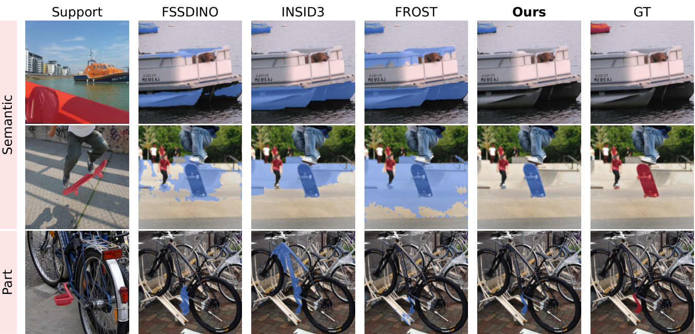

# Where to Cut? Adaptive Thresholds for Density-Ratio Few-Shot Segmentation

Training-free few-shot segmentation from frozen DINOv3 features. A query
token is scored by a kernel density ratio between the support's foreground
and background (as in FROST), fused with a support-to-query attention term.
Instead of cutting that score at the Bayes zero of an equal class prior, the
threshold is read from the query itself: a valley separator on the histogram
of the score's positive part, corrected by shrinkage, with no threshold
constant to tune. Every hyper-parameter is a fixed constant across all
benchmarks, domains and shot counts.

<p align="center"></p>

*One episode each from LVIS-92<sup>i</sup> and COCO-20<sup>i</sup> (semantic) and
PACO-Part (part segmentation). FSSDINO's prototype loses what departs from the
support mean, INSID3's partition swallows the target, FROST's zero cut spills
into look-alike background; the adaptive cut stops at the object.*

## Main results

Foreground mIoU on nine benchmarks (INSID3 protocol; all folds, all episodes,
seed 1), as in the paper's Table 2. FSSDINO, INSID3, FROST and ours use a
frozen DINOv3 ViT-L/16; best of these four in **bold**, second
<ins>underlined</ins>. Matcher and GF-SAM (marked †) rely on SAM, i.e. are
training-free variants that received mask supervision during pre-training;
their results are taken over from INSID3 and not ranked. PerMIS is 1-shot
only (one support frame per episode), so the 5-shot Avg is over eight
benchmarks.

| Method | LVIS-92<sup>i</sup> | COCO-20<sup>i</sup> | ISIC | SUIM | iSAID | X-Ray | PASCAL | PACO | PerMIS | Avg |
|---|---:|---:|---:|---:|---:|---:|---:|---:|---:|---:|
| **1-shot** | | | | | | | | | | |
| Matcher† | 33.0 | 52.7 | 38.6 | 44.1 | 33.3 | 70.8 | 42.9 | 34.7 | 63.8 | 46.0 |
| GF-SAM† | 35.2 | 58.7 | 48.7 | 53.1 | 47.1 | 51.0 | 44.5 | 36.3 | 54.1 | 47.6 |
| FSSDINO | 33.8 | 51.3 | 53.0 | 52.5 | 47.2 | 76.7 | 50.3 | 35.2 | 48.5 | 49.8 |
| INSID3 | <ins>41.5</ins> | <ins>58.3</ins> | 54.0 | 53.4 | <ins>51.7</ins> | 78.6 | 49.1 | <ins>38.5</ins> | <ins>67.0</ins> | <ins>54.7</ins> |
| FROST | 32.3 | 48.1 | <ins>54.4</ins> | <ins>58.1</ins> | 49.1 | <ins>84.8</ins> | <ins>54.3</ins> | 36.8 | 66.6 | 53.8 |
| **Ours** | **42.3** | **58.7** | **58.4** | **58.4** | **52.1** | **90.5** | **56.6** | **42.3** | **67.8** | **58.6** |
| **5-shot** | | | | | | | | | | |
| Matcher† | 40.0 | 60.7 | 35.0 | 50.6 | 34.3 | 71.2 | 45.8 | 33.6 | -- | 46.4 |
| GF-SAM† | 44.2 | 66.8 | 55.2 | 58.1 | 52.4 | 52.9 | 51.2 | 41.9 | -- | 52.8 |
| FSSDINO | 43.4 | 60.6 | 63.6 | 62.8 | 58.5 | 78.6 | 60.8 | 45.8 | -- | 59.2 |
| INSID3 | <ins>47.5</ins> | <ins>64.3</ins> | 63.9 | 63.1 | 60.1 | 79.4 | 58.4 | 47.0 | -- | 60.5 |
| FROST | <ins>47.5</ins> | 61.8 | **66.7** | **67.2** | <ins>61.0</ins> | <ins>86.4</ins> | <ins>68.0</ins> | <ins>51.3</ins> | -- | <ins>63.7</ins> |
| **Ours** | **52.2** | **67.3** | <ins>65.3</ins> | <ins>66.8</ins> | **61.9** | **91.8** | **68.4** | **54.3** | -- | **66.0** |

## Reproducing the table

```bash
pip install -r requirements.txt
cp env.example.sh env.sh   # fill in DINO_WEIGHTS and DATA_ROOT
source env.sh
GPUS="0 1 2 3" bash run_final.sh
```

`run_final.sh` is the whole experiment: one job per (benchmark, shot count),
17 in total (PerMIS at 1-shot only), spread round-robin over `$GPUS`. Each job
evaluates every fold of its benchmark with seed 1
(`results/k{1,5}/<benchmark>/results.json`, per-fold numbers included), and
the script ends by printing our rows of the table above to `results/table.md`.
Finished jobs are skipped on re-runs, so the script resumes. Budget several
GPU-days in total; LVIS-92<sup>i</sup> alone is 10 folds × 2300 episodes, and
5-shot LVIS peaks at ~19 GB of GPU memory. `MAX_EPISODES=50 bash run_final.sh
isic` is a quick smoke test.

Only our rows are computed by this repository. The FROST, INSID3 and FSSDINO
rows are our runs of their public code under the INSID3 protocol; the Matcher
and GF-SAM rows are taken from the INSID3 paper.

**Seeds.** The seed fixes which episodes are sampled. The main table uses
seed 1 with all folds and all episodes (PerMIS episodes are fixed, so the seed
does not affect them). Ablations and hyper-parameter selection used a separate
development setting: fold 0, 250 episodes per benchmark, seed 0. The ablation
numbers in the paper (Tables 3 and 4, Section 5.2) and the supplement come from
that setting, so `run_final.sh` will not reproduce them.

### Weights

The DINOv3 ViT-L/16 LVD-1689M checkpoint from
[facebookresearch/dinov3](https://github.com/facebookresearch/dinov3),
`dinov3_vitl16_pretrain_lvd1689m-8aa4cbdd.pth`. The backbone is loaded via
`torch.hub` from that repository (network access on first use).

### Data

[`docs/DATA.md`](docs/DATA.md) has the full download and preparation
instructions (adapted from INSID3's data guide). `$DATA_ROOT` layout:

```
$DATA_ROOT/
  COCO2014/{train2014, annotations, splits/val/fold{0..3}.pkl}
  LVIS/{coco, lvis_val.pkl}
  Pascal-Part/VOCdevkit/VOC2010/{JPEGImages, Annotations_Part_json_merged_part_classes, all_obj_part_to_image.json}
  PACO-Part/{coco, paco}
  iSAID/{val/images, val/semantic_png, splits/val/fold{0..2}.txt}
  ISIC/{ISIC2018_Task1-2_Training_Input, ISIC2018_Task1_Training_GroundTruth}
  LungSegmentation/{CXR_png, masks}
  SUIM/{images, masks}
  PerMIRS/{0, 4, 5, ...}/{0.jpg, 1.jpg, 2.jpg, masks.npz.npy}
```

## Using the model

```python
from PIL import Image
from model import build_frost

model = build_frost("dinov3_vitl16_pretrain_lvd1689m-8aa4cbdd.pth", device="cuda")
model.set_reference(Image.open("ref1.jpg").convert("RGB"), Image.open("ref1_mask.png"))
model.set_reference(Image.open("ref2.jpg").convert("RGB"), Image.open("ref2_mask.png"))
model.set_target(Image.open("query.jpg").convert("RGB"))
mask = model.segment()   # (H, W) bool at the query's resolution
```

`demo.py` wraps the 1-shot case on the command line.

## Layout

```
model/        the method: encoder.py (DINOv3), data.py, density.py (kernel density ratio),
              threshold.py (adaptive cut), model.py (pipeline + fixed constants)
datasets/     episodic benchmark loaders, vendored from INSID3
eval.py       evaluates one benchmark at one shot count over all its folds
run_final.sh  runs the 17 jobs and prints our rows of the table
```

## Paper ↔ code

| paper | code |
|---|---|
| density ratio ℓ_σ (Eq. 2) | `ell` — `model/density.py`: `kde_log_posterior` |
| correspondence term fwd (Eq. 4) | `fwd` — `model/model.py`: `_correspondence_fields` |
| score s(q) = ℓ_σ + λ·fwd (Eq. 5) | `score = ell + SCORE_LAMBDA * fwd` — `model/model.py`: `predict_mask` |
| statistics window R = {s > 0} (Eq. 6) | `_post_cand` — `model/model.py`: `predict_mask` |
| valley cut, shrinkage 1/(1 + a·π̂) (Eq. 7) | `model/threshold.py`: `windowed_valley_tau` (Glasbey valley, Otsu π̂) |
| veto 𝒱 (reciprocal-kNN vote, Eq. 8) | `model/model.py`: `_locate_candidates`, applied in `_finalize_mask` |
| positional debias / whitening | `model/model.py`: `_debias_features`, `_shrinkage_whiten` |
| σ = 0.05, T = 0.1, λ = 0.5, a = 1 | `SIGMA`, `ATT_T`, `SCORE_LAMBDA` in `model/model.py`; `PI_SHRINK_A` in `model/threshold.py` |

## Credits and license

* The pipeline builds on **FROST** (Junghwan Park, *Training-Free Few-Shot
  Segmentation with Frozen Features and Nonparametric Statistics*, 2026;
  [code](https://github.com/jhpark-ai/FROST), Apache-2.0): feature refinement
  and the kernel density ratio are FROST's.
* The benchmark loaders in `datasets/` are vendored from **INSID3** (Claudia
  Cuttano, Gabriele Trivigno, Christoph Reich, Daniel Cremers, Carlo Masone,
  Stefan Roth, *INSID3: Training-Free In-Context Segmentation with DINOv3*, CVPR 2026;
  [code](https://github.com/visinf/INSID3), Apache-2.0), whose evaluation
  protocol we follow.
* The backbone is **DINOv3** (Meta AI), under its own license.

This repository is released under the Apache License 2.0 (see `LICENSE`).
